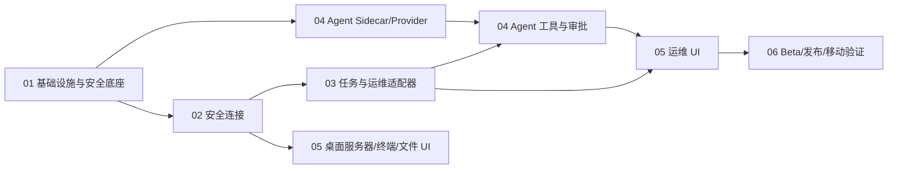

# OpsPilot 项目总实施路线图

> **For agentic workers:** REQUIRED SUB-SKILL: Use superpowers:subagent-driven-development (recommended) or superpowers:executing-plans to implement this plan task-by-task. Steps use checkbox (`- [ ]`) syntax for tracking.

**Goal:** 从绿色仓库交付一个可在 macOS 与 Windows 安装的 OpsPilot：它以 Tauri 2 + Rust Core 安全管理 Linux 服务器，并由本地 Mastra Sidecar 通过远程模型提供可审查、可审批、可审计的 AI 运维闭环。

**Architecture:** React/WebView 只负责展示与交互；Tauri/Rust Core 持有 SSH、SFTP、凭据、风险判定、任务、快照和审计权限；Mastra 运行在受控 Node Sidecar 中，通过带会话认证的 JSONL stdio IPC 调用 Rust Core 的类型化工具。远端服务器无需常驻 Agent，人工运维功能不依赖模型可用性。

**Tech Stack:** Node.js 24 LTS、pnpm workspace、Tauri 2、React/TypeScript/Vite、TanStack Router/Query、Zustand、xterm.js、Monaco、ECharts、Rust/Tokio、russh、SQLite、Mastra、Vitest、Rust tests、Playwright（纯渲染器）、WebdriverIO Tauri service（原生壳）、GitHub Actions。

## Global Constraints

- 首个正式版本仅面向 macOS 与 Windows 客户端，远端优先支持主流 Linux 与 systemd。
- 本地 Mastra Agent 是 MVP 必选能力；受管服务器不安装常驻 AI Agent。
- 模型配置固定为 `Base URL + API Key + Model`；API Key、SSH 密码、私钥口令和 Token 只进入系统凭据库。
- React/WebView 不直接访问模型密钥、SSH 凭据、任意 Shell、任意本地文件或不受控网络能力。
- Rust Core 对工具目标、参数、权限和风险做最终确定性判定；大模型不能降低风险或绕过审批。
- L0 可自动执行并审计；L1/L2 显式确认；L3 二次确认、输入资源名、强制快照；L4 不提供 Agent 结构化工具。
- 所有会对受管服务器产生副作用的人工或 Agent 写操作，其唯一入口都是 Rust `OperationGateway`；先持久化不可变 `ToolCall`，再依次完成风险判定、审批、快照、`TaskEngine` 和审计。适配器、Tauri command、Sidecar 均不得直接调用写 executor。
- 每个远端写操作必须绑定不可变 `tool_call_id`、`run_id`、参数摘要和目标服务器；人工操作由 Core 创建 manual run，Agent 操作复用 agent run。恢复时先查询真实状态，禁止自动重放。纯本地非敏感元数据 CRUD 可走事务 repository，但仍须写审计；凭据、更新与签名配置等高权本地写入使用各自的类型化安全服务，不向 WebView 暴露原始能力。
- SQLite 启用 WAL 与外键；敏感值只保存 `secret_ref`，日志和模型上下文先裁剪、再字段级脱敏。
- AI、Sidecar 或网络不可用时，终端、文件、Docker、Nginx、任务和审计必须继续可用。
- 冷启动小于 2 秒指“本地数据库打开并显示可交互 AppShell”，Sidecar 在 AppShell 可交互后异步预热，不阻塞该指标；Agent ready 和首次远程模型响应分别计时。
- 基准负载为 100 台服务器元数据、默认最多 8 个并发建连、16 个活跃 SSH transport、32 个终端 channel、8 个监控轮询；所有关键任务有进度、可取消性说明、错误详情和恢复路径。
- MVP 不包含数据库可视化、Kubernetes、团队 RBAC、云端长期告警、证书自动化或插件市场。
- 仓库/包命名使用 `ssh-ops-desktop`；界面产品名使用设计稿中的 `OpsPilot`。

---

## 1. 计划套件

| 顺序 | 计划 | 可独立验收的交付物 | 主要阶段 |
|---|---|---|---|
| 1 | [01 基础设施与安全底座](./2026-08-06-opspilot-foundation-plan.md) | 可启动桌面壳、共享契约、SQLite、凭据库、审计与双平台 CI | P0 |
| 2 | [02 安全连接、终端与文件](./2026-08-06-opspilot-connectivity-plan.md) | Server CRUD、known_hosts、SSH Shell、xterm 数据流、SFTP | P0 |
| 3 | [03 任务引擎与运维适配器](./2026-08-06-opspilot-operations-plan.md) | 任务/快照、概览、systemd、项目部署、Docker、Nginx | P1/P2 |
| 4 | [04 Mastra Agent 与审批闭环](./2026-08-06-opspilot-agent-plan.md) | Sidecar、Provider、只读工具、对话、审批、恢复与降级 | P0/P1 |
| 5 | [05 桌面交互与端到端闭环](./2026-08-06-opspilot-desktop-ui-plan.md) | 7 个桌面工作区、无障碍、跨模块 E2E | P1 |
| 6 | [06 Beta、发布与移动验证](./2026-08-06-opspilot-beta-mobile-release-plan.md) | 部署回滚、监控/导出、签名更新、7 个移动原型、P3/P4 决策包 | P2/P3 |
| 跟踪 | [独立 TodoList](./2026-08-06-opspilot-todolist.md) | 跨计划依赖、状态与里程碑总清单 | 全程 |
| 审计 | [计划审核处置记录](../2026-08-06-opspilot-plan-audit-resolution.md) | 外部报告逐条判定、修复落点与上游依据 | 动工前 |

## 2. 固化的跨层接口

以下名称必须在所有子计划中保持一致；若执行时确需修改，应先更新这里和所有消费者，再进入实现。

```ts
export type Id = string;
export type RiskLevel = 'L0' | 'L1' | 'L2' | 'L3' | 'L4';
export type TaskStatus =
  | 'pending' | 'running' | 'succeeded' | 'failed' | 'cancelled'
  | 'interrupted' | 'rolling_back' | 'rolled_back' | 'rollback_failed';

export interface ToolCall {
  toolCallId: Id;
  runId: Id;
  serverId: Id;
  name: string;
  schemaVersion: 1;
  args: unknown;
}

export interface ApprovalProof {
  approvalId: Id;
  toolCallId: Id;
  argsDigest: string;
  confirmedResource?: string;
}

export interface RiskDecision {
  level: RiskLevel;
  approvalRequired: boolean;
  snapshotRequired: boolean;
  confirmationText?: string;
  reason: string;
}
```

```rust
pub enum OperationActor {
    Manual { manual_run_id: Id, window_id: Id },
    Agent { agent_run_id: Id },
}

pub enum PrepareResult {
    ReadCompleted { tool_call_id: Id, result: ToolResult },
    AwaitingApproval(PreparedOperation),
    Blocked { tool_call_id: Id, risk: RiskDecision },
}

pub struct PreparedOperation {
    pub approval_id: Id,
    pub tool_call_id: Id,
    pub run_id: Id,
    pub server_id: Id,
    pub args_digest: Sha256Digest,
    pub risk: RiskDecision,
    pub target_label: String,
    pub confirmation_target: Option<String>,
    pub impact_summary: String,
    pub expires_at: DateTime<Utc>,
}

pub struct TaskRef { pub task_id: Id, pub tool_call_id: Id }
pub enum ApprovalState { Pending, Approved { task_id: Id }, Rejected, Expired }
pub enum OperationState { ReadCompleted, AwaitingApproval(ApprovalState), Task(TaskStatus) }
pub enum ToolAction { Read(ToolResult), Write(OperationPlan) }

pub trait ToolExecutor: Send + Sync {
    fn definition(&self) -> ToolDefinition;
    async fn prepare(&self, ctx: &ToolContext, args: serde_json::Value)
        -> Result<ToolAction, CoreError>;
}

pub trait OperationGateway: Send + Sync {
    async fn prepare(&self, call: ToolCall, actor: OperationActor)
        -> Result<PrepareResult, CoreError>;
    async fn approve_and_submit(&self, proof: ApprovalProof)
        -> Result<TaskRef, CoreError>;
    async fn reject(&self, approval_id: Id) -> Result<ApprovalState, CoreError>;
    async fn status(&self, tool_call_id: Id) -> Result<OperationState, CoreError>;
}

pub trait Snapshotter: Send + Sync {
    async fn create(&self, request: SnapshotRequest) -> Result<SnapshotRef, CoreError>;
    async fn restore(&self, snapshot: &SnapshotRef) -> Result<(), CoreError>;
}
```

- `ToolCall.runId` 是一次用户意图/执行会话的关联 ID：人工 UI 由 Core 创建 manual run，Agent 使用现有 agent run；任何调用方都不能自报 actor、risk、policyVersion 或 snapshotRequired。
- L0 读取由 `OperationGateway.prepare` 校验、审计后同步返回；L1-L3 写入返回持久化的 `PreparedOperation`，只有 `approve_and_submit` 能进入 executor；`reject` 幂等且零副作用，`status` 是人工/Sidecar 恢复的唯一事实源。L4 只返回不可执行的 `RiskDecision`。
- `RiskDecision.confirmationText` 只是 Rust 生成的本地化展示文案，UI/Sidecar 不得解析它来判定通过。L3 prepare 必须把同一份不可变资源标识写入 `PreparedOperation.target_label` 与 `confirmation_target`；approve 时规范化后比较 `ApprovalProof.confirmedResource == confirmation_target`。L1/L2 的 `confirmation_target=None` 且不得接收 `confirmedResource`。因此展示文案变化不会改变审批契约，目标或 digest 变化则使原审批失效。
- `ToolExecutor.prepare` 的 L0 结果是 `ToolAction::Read`；写工具只能返回 `ToolAction::Write(OperationPlan)`。OperationPlan 必须携带同一 `toolCallId/runId/argsDigest/serverId/environment/resourceScope`，不能成为第二个入口。

## 3. 依赖与并行边界



- `01` 必须先完成；它定义 ID、错误、契约、持久化、凭据和 CI。
- `02` 与 `04` 的 Sidecar/Provider 前半段可并行，但 Agent 只读工具必须等待 `02` 的 SSH 能力。
- `02` 在传输任务中建立最小 `OperationGateway`、ToolCall/Approval 持久化和审计闭环；`03` 只扩展 OperationPlan、快照、风险策略与运维 executor，不能另建入口。
- `04` Task 5 必须等待 `02` Task 5 与 `03` Task 1/4/6/7 完成；它只在 `agent-bridge` 注册既有 executor 并调用共享 operation command，不再修改 `src-tauri/src/commands/operation.rs`，避免跨计划并行覆盖同一所有权文件。
- `03` 的扩展任务引擎、快照和风险策略必须先于 Agent 写工具注册与审批 Workflow。
- `05` 可先使用契约 fixture 开发，但跨模块 E2E 必须在 `02`、`03`、`04` 通过后执行。
- `06` 只在桌面 MVP 验收门通过后开始；移动端不进入 MVP 阻塞路径。

## 4. 里程碑与退出门

### M0：仓库健康（完成 01）

- `pnpm lint && pnpm typecheck && pnpm test` 退出码为 0。
- `cargo fmt --check && cargo clippy --workspace --all-targets -- -D warnings && cargo test --workspace` 退出码为 0。
- Tauri 桌面壳可在 macOS 启动，Windows CI 至少完成编译。
- 迁移测试证明 SQLite 启用 `foreign_keys=ON` 和 `journal_mode=WAL`。
- 凭据与审计测试证明秘密不进入 SQLite、事件或日志。

### M1：P0 技术验证（先完成 02，再完成 04 的 P0 项）

M1 拆成串行子门，避免 Agent 只读工具在 SSH 能力未稳定时提前联调：

- **M1a / Connectivity：** 先完成 `02` 的 Server/TOFU/SSH/终端/SFTP 与真实 SSH fixture。
- **M1b / Agent Read-only：** M1a 通过后，再完成 `04` 的 Sidecar/Provider/L0 tool；Sidecar/Provider 的不依赖 SSH 部分可提前并行开发，但不能宣告 M1b 通过。

- 首次主机指纹必须确认，变化指纹必须阻断。
- 密码和私钥认证均能连接 Docker SSH fixture。
- xterm.js 可交互、缩放、断线提示并手动重连；SFTP 可浏览、上传、下载。
- Sidecar 完成会话认证握手、Provider 连通性测试和一个 L0 只读工具调用。
- 模型与 Sidecar 关闭时，SSH/终端/SFTP 集成测试仍通过。

### M2：P1 MVP（完成 03、04、05 的 MVP 项）

- 桌面 7 个核心工作区均可导航并覆盖桌面高保真稿中的主路径。
- 文件、systemd、项目、Docker、Nginx 的写操作全部从 `ToolCall → OperationGateway → RiskDecision → Approval → Snapshot（若需）→ TaskEngine → Audit` 进入，抽样审计可反查同一组 ID/digest。
- Nginx 变更实现临时文件、Diff、`nginx -t`、原子替换、reload、健康检查和失败恢复。
- Agent 可解释服务器状态、生成计划、调用 L0 工具；L1-L3 按策略暂停，拒绝后零副作用。
- 设计文档标题“`## 20. MVP 验收标准`”（按标题匹配，不按章节序号）全部映射到自动测试或有证据的双平台手工检查。
- 100 台元数据 + 16 个活跃连接 + 32 个终端 channel 的基准场景无串流/死锁；监控轮询并发固定为 8，队列有背压证据。

### M3：P2 Beta（完成 06 的前 3 项）

- Release 目录/current 软链接部署和 Compose 回滚均通过故障注入。
- 监控、桌面告警、加密导出、诊断包预览可用且无敏感数据泄漏。
- macOS Apple Silicon、`macos-15-intel` 原生 Intel 与 Windows x64 构建矩阵产出签名候选包；runner 不可用时发布门失败，不能用未运行的交叉编译产物代替安装验证。
- stable/beta/nightly 使用独立 update key/manifest allowlist；migration/bootstrap health 失败在 recovery bootstrap 可启动时恢复数据并签名降级，新 binary 完全不可启动时提供已演练的上一版本签名安装器，不宣称 Updater 可自动自救。

### M4：P3 规划门（完成 06 的移动验证和扩展决策包）

- 7 张移动稿均有 fixture 驱动的响应式可运行页面与触控/无障碍测试。
- 不发布具有写权限的移动客户端；先完成移动端凭据、SSH、Agent 运行位置、同步、丢失设备与远程撤销威胁模型。
- 证书、计划任务、插件 API 各有版本化契约和一个受控样例，但不扩大 MVP。

## 5. 每个任务的强制执行循环

每个子计划任务必须按以下顺序执行，不能把测试补在实现之后：

1. 只读取该任务列出的文件、接口和前置产物。
2. 写一个只验证单一行为的失败测试。
3. 运行任务给出的精确命令并确认因缺少目标行为而失败。
4. 写使该测试通过的最小实现。
5. 运行任务级测试，再运行受影响 workspace 的回归测试。
6. 运行格式化、静态检查和安全日志扫描。
7. 复核 `git diff --check`，只提交该任务文件。

全局验证命令：

```bash
pnpm lint
pnpm typecheck
pnpm test --run
pnpm contracts:check
cargo fmt --check
cargo clippy --workspace --all-targets -- -D warnings
cargo test --workspace
pnpm test:integration
pnpm test:e2e:renderer
pnpm tauri build --debug
pnpm test:e2e:native
```

`cargo test --workspace` 与 `pnpm test:integration` 只运行无外部服务的测试；Docker/SSH/Nginx 真实 fixture 测试统一标记 ignored/feature-gated，只能由各计划给出的 `run-*.sh` 在启动并探测 fixture 后显式执行。
兼容旧 CI/文档的聚合入口为 `pnpm test:e2e`（renderer → debug build → native）；需要真实外部服务时使用 `pnpm test:integration:external`，需要本地与外部全量验证时使用 `pnpm test:integration:all`。不得把 external fixtures 混入默认 `pnpm test:integration`。

## 6. 研究结论与实施约束

- 使用 Node.js 24 LTS；Node 官方在 2026-08 仍将 v24 标为 LTS，避免用 v26 Current 作为生产 Sidecar 基线：<https://nodejs.org/en/about/previous-releases>。
- Tauri 外部二进制必须按 target triple 命名，且 `externalBin` 只登记受控 Sidecar：<https://v2.tauri.app/develop/sidecar/>。
- Node SEA 当前仍是 Active development，且官方 CI 不覆盖 macOS x64；因此首版不采用 SEA，而是在各原生 CI runner 上把官方 Node LTS 二进制作为 Sidecar runtime，并把已 bundle 的 Agent JS 作为只读 resource：<https://nodejs.org/api/single-executable-applications.html>。
- WebView capability 只允许 `core:event`、`core:window` 和应用显式命令；Sidecar 由 Rust 启动，前端没有 `shell:allow-spawn`：<https://v2.tauri.app/security/capabilities/>。
- 原生桌面 E2E 使用 WebdriverIO `@wdio/tauri-service` 的 embedded provider，覆盖 macOS/Windows Tauri binary；Playwright 只跑 Vite/Chromium renderer fixture 与视觉测试，不把浏览器结果称为原生或真实 SSH E2E：<https://v2.tauri.app/develop/tests/webdriver/>。
- Mastra 工具使用输入 schema；审批与 Workflow suspend/resume 只承担编排，最终风险判定仍留在 Rust：<https://mastra.ai/docs/agents/mcp-guide>、<https://mastra.ai/ai-agent-framework>。
- xterm.js addon 必须显式 `loadAddon`；WebLink 激活交给 Tauri 打开外部浏览器并要求修饰键：<https://xtermjs.org/docs/guides/using-addons/>、<https://xtermjs.org/docs/guides/link-handling/>。

## 7. 需求覆盖索引

| 规格章节 | 实施位置 |
|---|---|
| 服务器、凭据、主机指纹 | 01 Task 3-4；02 Task 1-3 |
| SSH 终端、端口转发 | 02 Task 3-4、6；05 Task 3 |
| SFTP、编辑、传输任务 | 02 Task 5；05 Task 3 |
| 概览、systemd、端口、监控 | 03 Task 2；05 Task 5；06 Task 2 |
| 项目检测、部署、健康检查、回滚 | 03 Task 3-4；06 Task 1 |
| Docker/Compose | 03 Task 5-6；05 Task 5 |
| Nginx 安全变更 | 03 Task 7；05 Task 5 |
| 任务、快照、审计、脱敏 | 01 Task 4；03 Task 1 |
| Mastra、Provider、IPC、Agent | 04 Task 1-4 |
| 风险、审批、恢复、降级 | 03 Task 1；04 Task 5-6 |
| 桌面 7 张设计稿 | 05 Task 1-6 |
| 移动 7 张设计稿 | 06 Task 4 |
| 构建、签名、更新、SBOM | 01 Task 5；06 Task 3 |
| P3/P4 延后项 | 06 Task 5；总路线图 M4 |

## 8. 总计划执行清单

- [ ] **Step 1:** 执行 `01`，通过 M0，并在 TodoList 中勾选 FND 全部项目。
- [ ] **Step 2:** 执行 `02` 与 `04` 的 P0 项，通过 M1，并保存 Docker SSH fixture 证据。
- [ ] **Step 3:** 执行 `03`、`04` 剩余项与 `05`，逐条核对设计文档标题“`## 20. MVP 验收标准`”，通过 M2。
- [ ] **Step 4:** 执行 `06` 的 Beta 项，通过双平台打包、迁移和回滚门 M3。
- [ ] **Step 5:** 完成移动原型与 P3/P4 决策包，通过 M4；为真正移动端/团队版另写经批准的规格和实施计划。
